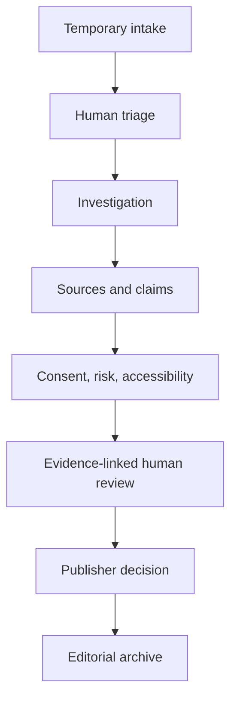

# Web Engine Architecture

## Stack

- Browser prototype: semantic HTML, CSS, ES modules, and IndexedDB for local-only workflow testing.
- Production-oriented application: Next.js App Router, TypeScript, Supabase Auth and PostgreSQL with row-level security, hosted on Vercel.
- Structured research records: investigations, sources, checkable claims, claim-to-source evidence links, consent/risk/accessibility reviews, publication decisions, and audit history.
- Temporary intake: isolated queue with a 72-hour TTL; a person must promote material into a permanent investigation.
- AI is not connected to the production scaffold. Human review owns claim outcomes and publication status.

## Governed Flow

The first release keeps research private by default. The publication status is a workflow decision; public article rendering and distribution are not implemented. PostgreSQL rejects a public status change unless consent is cleared, risk and accessibility are reviewed, every claim has a human review and linked source, and no claim is disputed. Only a user assigned the publisher role may change publication status.

## Release status

`app/` remains the browser-only prototype. `backend/` is the first independently deployable app scaffold; it needs a project owner to configure Supabase and Vercel before a hosted service can go live. The migration contains the role model, RLS policies, database publication guard, append-only audit events, and scheduled cleanup for expired intake.

The initial app is a single workspace. Multi-workspace tenancy, file uploads, offline conflict resolution, API ingestion, and public article delivery need separate design and are not implied by the scaffold.

## Source

The original stage order comes from `09_web_engine/WEB_ENGINE_MVP.md` and `architecture/governance-pipeline.md`. The production scaffold adds persistent storage and enforceable publication controls without changing the prototype's local-only behavior.
